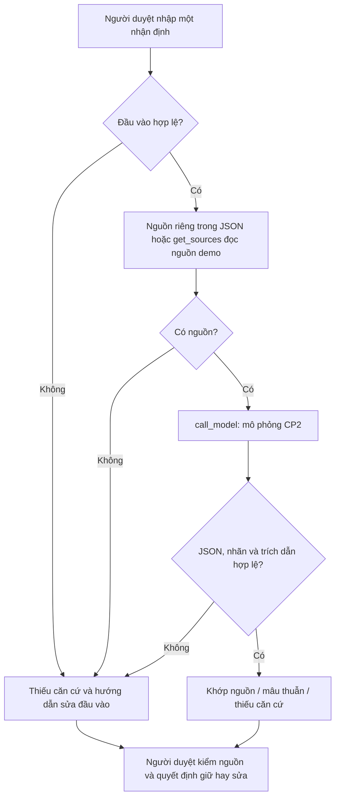

# Bàn giao CP2 — Nguyễn Minh Thành · Track A3

Phần việc: bản chạy giả từ một nhận định và các đoạn nguồn đến một trong ba nhãn **khớp nguồn**, **mâu thuẫn**, **thiếu căn cứ**, kèm bước xử lý và chỗ người duyệt quyết định.

## Chạy

Từ thư mục gốc kho bài tập:

```bash
cd starter-repo
python run.py
```

Không cần cài thư viện hay API key. Mặc định khi chưa cấu hình model, chương trình tự chạy ba ca minh họa rồi cho nhập nhận định. Gõ `:demo` để chạy lại, Enter hai lần hoặc Ctrl+C để thoát. Nếu máy không có lệnh `python`, dùng `python3`.

| Ca | Nhận định | Kết quả đề xuất |
|---|---|---|
| Khớp | Trong quy trình mẫu, người duyệt quyết định nội dung trước khi xuất bản. | khớp nguồn, trích [DEMO-A3-01] |
| Mâu thuẫn | Trong quy trình mẫu, người duyệt không quyết định nội dung trước khi xuất bản. | mâu thuẫn, trích [DEMO-A3-01] |
| Thiếu căn cứ | Trong quy trình mẫu, video dài đúng 12 phút. | thiếu căn cứ, yêu cầu thêm nguồn/kiểm thủ công |

Các ca nằm trong `data/demo_cases.json`, tách khỏi mã xử lý. Đây là minh họa chức năng, không phải bộ benchmark hay bằng chứng pain.

## Hợp đồng đầu vào/đầu ra để hai cặp làm song song

`answer(text)` nhận nguyên chuỗi từ ô `input` trong benchmark. Có hai cách nhập:

- Một dòng nhận định: dùng ba nguồn mặc định trong `data/demo_sources.json`.
- JSON một dòng chứa nhận định và nguồn riêng của câu thử:

```json
{"claim":"Bài mẫu không dùng sơ đồ cây.","sources":[{"code":"LOCAL-7","text":"Bài mẫu dùng sơ đồ cây."}]}
```

Không truyền `expected` hay nhãn mong muốn vào chương trình. `sources: []` nghĩa là thực sự không có nguồn, trả thiếu căn cứ. Bỏ trường `sources` thì dùng nguồn demo. Mỗi đoạn có mã duy nhất gồm chữ không dấu, số, dấu chấm, gạch ngang hoặc gạch dưới. Giới hạn: một nhận định tối đa 2.000 ký tự, tối đa 20 nguồn, mỗi nguồn tối đa 5.000 ký tự, tổng chuỗi đầu vào tối đa 50.000 ký tự.

Đầu ra giữ khóa `output` dạng chữ để khung eval/simulate dùng được. Các khóa bổ sung:

```json
{
  "label": "mau_thuan",
  "reason": "Mô phỏng: nhận định và nguồn khác nhau bởi một từ phủ định 'không'; cần người duyệt kiểm nghĩa.",
  "citations": [{"code": "LOCAL-7", "quote": "Bài mẫu dùng sơ đồ cây."}],
  "claim": "Bài mẫu không dùng sơ đồ cây.",
  "requires_review": true,
  "mode": "fake",
  "output": "... nhận xét tiếng Việt, nguồn, bước tiếp theo và trạng thái chờ duyệt ..."
}
```

`label` chỉ có `khop_nguon`, `mau_thuan`, `thieu_can_cu`. Hai nhãn đầu bắt buộc có mã nguồn trong đầu vào và trích dẫn nguyên văn; nhãn cuối không gắn nguồn kết luận.

## Luồng và giới hạn



Workflow cố định, một lần gọi model khi có nguồn, không có vòng lặp agent. `get_sources()` là công cụ chỉ đọc có `@tool`; nguồn riêng được kiểm cấu trúc trực tiếp. Trace vẫn dùng nguyên khung.

Chế độ `fake` dùng quy tắc tổng quát: trùng câu sau chuẩn hóa chữ → khớp; thêm/bỏ đúng một từ “không” → mâu thuẫn mô phỏng; diễn đạt khác → thiếu căn cứ. Nguồn vừa khớp vừa phủ định nhau cũng chuyển người duyệt. Quy tắc phủ định có thể sai ngữ nghĩa; bản này chỉ chứng minh luồng CP2, chưa đo khả năng kiểm kiến thức hoặc chống tấn công của model thật.

Prompt coi nhận định và nguồn là dữ liệu. Hệ thống kiểm mã nguồn và trích dẫn trước khi hiển thị; kiểm cấu trúc này chưa chứng minh trích dẫn hỗ trợ kết luận. Không có công cụ gửi, sửa kịch bản, duyệt hay xuất bản. Mọi đầu ra đều chờ người duyệt.

| Thành phần | Tình trạng |
|---|---|
| Đọc nguồn, kiểm đầu vào, kiểm trích dẫn, CLI và tracing | Chạy bằng Python thật |
| Nguồn mặc định | 3 đoạn synthetic do Codex soạn, chưa được nhóm xác nhận là nguồn đã duyệt |
| Quyết định trung tâm | Giả, model `fake`, token vào/ra bằng 0 |
| Model thật | Chưa nối; nhánh provider khác vẫn báo NotImplementedError |
| Bằng chứng người dùng, độ chính xác, chi phí model thật | Chưa thu/chưa đo trong phần việc này |

## Kiểm và bàn giao

```bash
python -m unittest discover -s tests -v
python run.py check
```

Các kiểm thử tự động xác minh ba nhánh, nguồn tùy ý, nguồn xung đột, đầu vào hỏng, thiếu nguồn, mã nguồn trùng, chỉ dẫn chèn trong dữ liệu, trích dẫn bịa và lỗi kết nối. Chúng không thay bộ benchmark hoặc chấm đạt cho sản phẩm.

- **Lê Quốc Khánh:** dùng hợp đồng và sơ đồ này để chốt `spec.md` §4; §7 do nhóm quyết định, không lấy kết quả mock làm số đo.
- **Nguyễn Nam Khánh:** có thể đưa JSON ở trên vào ô `input` của CSV, để mỗi câu mang nguồn riêng. Nguồn thật phải do nhóm chọn/duyệt; chuẩn hóa thành `{code, text}`. Thông tin nguồn demo ở [demo-sources.md](demo-sources.md) để bổ sung data card.
- **Nguyễn Minh Thành:** nối model thật ở `codebase/ai.py` trong chặng CP3 theo [connect-model.md](connect-model.md), giữ decorator và usage thật. Sau đó chạy `eval --try` trước khi chạy eval đầy đủ.

`run.py`, `tracing.py`, bộ chạy eval/simulate, benchmark và metric spec giữ nguyên. `python run.py check` kiểm các hồ sơ nhóm hiện có; thiếu sót trong benchmark/metric còn phải được người phụ trách hoàn thiện. Chạy mock không tạo lượt `run-N` hợp lệ.
