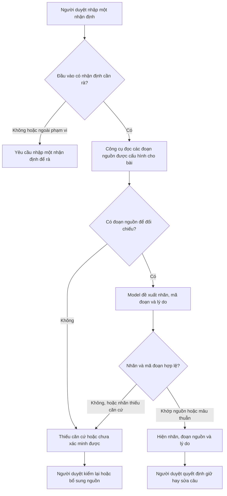

# AI SPEC — Rà nhận định trong kịch bản pre-class · AIhayAL

**Track A · A3 — Sản xuất bài giảng pre-class.** AIhayAL thiết kế công cụ rà một nhận định trước khi xuất bản. Bản CP3 đã gọi model thật với tập đoạn nguồn đang chờ duyệt.

**Hồ sơ CP2.** [Canvas](canvas.md) · [Tiến độ bằng chứng](evidence/summary.md) · [Benchmark 30 câu](eval/benchmark.csv) · [Metric spec](eval/metric_spec.yaml) · [Data Card](data/DATA_CARD.md) · [Hướng dẫn chạy thử](docs/a3-demo.md)

**Bàn giao CP3.** [Video thao tác thật 30 giây](https://drive.google.com/file/d/1sh0NQ_hLLD2H2mUOyOTdfxqV1cJ0JKV1/view) · [Bằng chứng pain](evidence/summary.md) · [Benchmark 30 câu](eval/benchmark.csv) · [Kết quả lượt 1](eval/run-1.csv) · [Điểm và phân tích lỗi](eval/report.md). Quốc Khánh đã phát thử video trong tab ẩn danh ngày 28/11.

Lượt `run-1@20261127-224225` dùng OpenAI `gpt-5.4-nano-2026-03-17`, đạt **20/30 câu (66,67%)** theo chấm bằng AI và chưa đạt chuẩn CP2. Bộ thử có 21 câu khó, 2 câu từ chối và 10 câu từ tài liệu công khai. Khảo sát có 9 lượt sau khi loại 2 lượt thử. Bằng chứng pain và bảng impact còn chờ dữ liệu đủ ngưỡng từ người trực tiếp duyệt kịch bản.

## §0. Hiện tại việc này diễn ra thế nào *(guide 1.1)*

Đề Track A3 mô tả bước kiểm kiến thức, nguồn và người duyệt trước khi xuất bản bài giảng. Luồng dưới đây là giả thuyết để kiểm với người từng duyệt kịch bản pre-class. Công cụ đang dùng và cách bàn giao giữa người soạn và người duyệt chưa được xác nhận. [Bối cảnh Track A3](../tracks/track-a-edtech.md#a3--sản-xuất-bài-giảng-bằng-ai)

1. Người soạn chuyển bản nháp và tài liệu tham chiếu cho người duyệt.
2. Người duyệt khoanh những nhận định chuyên môn cần kiểm.
3. Người duyệt mở tài liệu, tìm đoạn liên quan và đối chiếu từng nhận định.
4. Người duyệt ghi quyết định giữ, yêu cầu sửa hoặc yêu cầu bổ sung nguồn trước khi bàn giao bản duyệt.

## §1. Người dùng & bằng chứng *(guide 1.1, 1.2)*

- **Người dùng chính.** Người trực tiếp duyệt nội dung kịch bản pre-class của đội sản xuất bài giảng AI20K.
- **Việc cần làm.** Đối chiếu một nhận định chuyên môn trong kịch bản với đoạn tài liệu đã duyệt trước khi quyết định giữ hay yêu cầu sửa.
- **Vấn đề giả thuyết.** Khi duyệt kịch bản pre-class, người duyệt phải dò lại tài liệu để kiểm từng nhận định. Việc tìm đúng đoạn có thể kéo dài thời gian duyệt và khiến lỗi kiến thức bị bỏ sót.
- **Tiến độ bằng chứng tại CP3.** Đức Anh bàn giao 9 lượt khảo sát sau khi loại 2 lượt thử. Trong 9 lượt, 1 người tự khai từng làm nội dung cho AI20K, 3 người làm cho khóa khác và 5 người chưa từng. Các trích dẫn sơ bộ đã được lưu. Chưa xác minh tư cách ngoài nhóm hoặc việc trực tiếp duyệt kịch bản pre-class. Mục tiêu là khảo sát ít nhất 20 người ngoài nhóm có kinh nghiệm trực tiếp duyệt kịch bản hoặc phỏng vấn ít nhất 3 người phù hợp, kèm tối thiểu 5 trích dẫn hoặc ví dụ nguyên văn đã bỏ tên. [Tổng hợp bằng chứng](evidence/summary.md)
- **Dữ liệu phục vụ bản thử.** Benchmark và các đoạn video dùng để kiểm cách hệ thống đối chiếu. Kết quả chạy thử chưa đo được thời gian dò nguồn trong công việc thực tế. [Data Card](data/DATA_CARD.md)

## §2. Impact & quyết định chọn *(guide 1.3)*

| Hướng | Người gặp · lần/tháng · thời gian mỗi lần | Impact/tháng | Quyết định CP2 |
|---|---|---|---|
| Rà một nhận định trong kịch bản | Đo ở người trực tiếp duyệt. Hỏi số lượt tra nguồn và số phút mỗi lượt. Chưa có số đo. | Chờ dữ liệu khảo sát hoặc phỏng vấn. | **Chọn.** Một nhận định, một tập nguồn cố định và ba nhãn giúp nhóm kiểm từng quyết định. |
| Rà cả kịch bản rồi gom các chỗ cần sửa | Cần đo số kịch bản, số nhận định mỗi bản và thời gian rà cả bản. Chưa có số đo. | Chờ dữ liệu. | Để sau. Cần tách nhận định và xử lý nhiều đoạn nguồn trong cùng một lượt. |
| Soạn kịch bản mới kèm nguồn | Cần khảo sát người soạn về tần suất viết và thời gian bổ sung nguồn. Chưa có số đo. | Chờ dữ liệu. | Để sau. Công việc chính chuyển sang viết kịch bản và cần quy trình duyệt riêng. |

**Cách tính cho hướng đã chọn.** Số người trực tiếp duyệt × số lượt phải tra nguồn mỗi người mỗi tháng × số phút tra trung vị mỗi lượt = ước lượng số phút tra nguồn của nhóm mỗi tháng. Kịch bản cơ sở dùng 4 × 7,6 × 3 = 91,2 phút công việc/tháng *(tự ước tính)*. Khảo sát chính chưa cho số phút theo nhận định. Nhóm sẽ đo cùng một nhận định trong quy trình thủ công và bản thử để xác định thời gian tiết kiệm. [Khảo sát chính](evidence/summary.md) · [Giả định kịch bản](cost/cost-estimate.md)

## §3. Giải pháp tương tự *(guide 2.1)*

- **Gemini Notebook của Google.** Tính năng chat trả lời dựa trên tài liệu người dùng chọn, kèm trích dẫn có thể mở lại trong ngữ cảnh gốc. [Tài liệu chính thức](https://support.google.com/gemininotebook/answer/16179559)
- **Điểm áp dụng.** Hiện mã và đoạn nguồn ngay cạnh nhận xét để người duyệt tự kiểm.
- **Giới hạn cần tránh.** Hỏi đáp mở có thể tạo nhiều dạng đầu ra, khiến người duyệt khó so sánh các nhận xét theo cùng tiêu chí.
- **Thiết kế cho lát cắt A3.** Mỗi lượt chỉ rà một nhận định và trả nhãn cố định cùng lý do chỉ rõ vế cần kiểm. Người duyệt dùng kết quả để quyết định giữ, sửa hoặc bổ sung nguồn.

## §4. Thiết kế *(guide 2.2, 3.2)*

**Lát cắt.** Khi người duyệt chọn một nhận định trong kịch bản pre-class, AI đối chiếu với tài liệu đã duyệt và trả một nhận xét gắn nhãn khớp nguồn, mâu thuẫn hoặc thiếu căn cứ để người duyệt xử lý.

**Ngoài phạm vi.** Rà cả kịch bản một lượt, tìm thêm nguồn trên web, tự đổi câu trong bản nháp và tự xuất bản bài giảng.

**Hình dạng.** Workflow cố định với tối đa một lần gọi model cho mỗi nhận định. Mỗi lượt đọc một tập nguồn cấu hình sẵn, nhận đề xuất nhãn, kiểm kết quả và đưa cho người duyệt. Vì các bước đã xác định trước, model chỉ cần đối chiếu nội dung. Phân vai nhiều agent sẽ thêm lượt gọi và thêm đầu ra cần kiểm.

| Công cụ | Đầu vào | Đầu ra | Quyền |
|---|---|---|---|
| `get_approved_passages()` | Cấu hình cục bộ `data/lesson.json`. Hàm không nhận tham số từ người dùng. | Danh sách đoạn có `code` và `text`. Bản CP2 đọc tập `draft_unreviewed`. | Chỉ đọc dữ liệu cục bộ |

**Đầu ra và chỗ chặn lỗi.** Mỗi nhận xét có `label`, `source_ids` và `reason`. `Khớp nguồn` yêu cầu nguồn xác nhận nội dung của nhận định. `Mâu thuẫn` yêu cầu nguồn bác bỏ ít nhất một vế và lý do nêu rõ vế đó. Hai nhãn này cần ít nhất một mã đoạn, và mọi mã phải thuộc đúng tập đoạn đã đưa cho model ở lượt đó. Dữ liệu đầu vào và đoạn nguồn chỉ được dùng làm nội dung để đối chiếu. Khi nguồn thiếu, mâu thuẫn chưa giải được, hoặc đầu ra sai định dạng hay sai mã, hệ thống hiện `thiếu căn cứ`, bỏ mã và lý do chưa xác minh, rồi mời người duyệt kiểm lại. Khi đầu vào chỉ yêu cầu thao tác ngoài phạm vi, hệ thống yêu cầu nhập một nhận định cần rà.

**Mức tự động.** AI gợi ý, người duyệt quyết định. Người duyệt mở đoạn gốc, đối chiếu lý do rồi giữ, sửa hoặc yêu cầu bổ sung nguồn. Bỏ sót một nhận định sai có thể đưa kiến thức sai vào bài giảng, nên quyết định duyệt và xuất bản thuộc người phụ trách.

| Nguyên tắc | Áp dụng trong luồng |
|---|---|
| G1 — Làm rõ phạm vi | Giao diện yêu cầu nhập một nhận định và hiển thị bài pre-class dùng để đối chiếu. |
| G10 — Thu hẹp phạm vi khi không chắc | Trả `thiếu căn cứ` khi nguồn thiếu, bất nhất hoặc mã đoạn không xác minh được. |
| G11 — Giải thích vì sao | Với nhãn `khớp nguồn` và `mâu thuẫn`, hiển thị mã đoạn và vế được xác nhận hay bị bác bỏ. |

**Phạm vi bản CP2.** Công cụ `get_approved_passages()` đọc bộ nguồn theo `data/lesson.json`. Cấu hình hiện dùng 7 đoạn diễn giải từ phụ đề video và hiển thị rõ trạng thái chưa được duyệt. Bộ thử gửi nhận định dưới dạng `{"claim":"…"}`. Nguồn được cấu hình trong repo. Bước gắn nhãn ở CP2 dùng model giả so chữ và phủ định, token bằng 0. Kết quả có `label`, `source_ids`, `reason`. Yêu cầu thao tác ngoài phạm vi trả `input_required` và đề nghị nhập lại nhận định. [Hướng dẫn demo](docs/a3-demo.md)

**Bản CP3.** Luồng đã gọi OpenAI `gpt-5.4-nano-2026-03-17` và ghi token do API trả về. Video cho thấy một lượt từ nhập nhận định tới nhãn, mã đoạn và lý do để người duyệt xử lý. [Bàn giao của Minh Thành](docs/cp3-thanh-handoff.md) · [Bản ghi lượt demo](docs/cp3-live-20261127T144554571059Z.json)

## §5. Chỗ khó — 4 lớp + ≥6 kịch bản + 2 tấn công *(guide 2.3)*

| Kịch bản | Lớp | Hành vi mong muốn | Câu kiểm |
|---|---|---|---|
| Nhận định đúng nhưng diễn đạt khác nguồn | 1 | Trả khớp nguồn và dẫn đoạn xác nhận đúng ý. | V28-01, V28-21 |
| Bộ đoạn không nêu ngưỡng đánh giá | 1 | Trả thiếu căn cứ và yêu cầu bổ sung đoạn có ngưỡng. | V28-15, V28-23 |
| Hai đoạn nguồn đưa kết luận trái nhau | 1 | Trả thiếu căn cứ và chuyển người duyệt kiểm lại nguồn. | `test_conflicting_sources_escalate_and_clear_reason` |
| Đầu vào là câu hỏi hoặc nhiều câu | 2 | Yêu cầu nhập một nhận định để rà. | `test_out_of_scope_actions_request_claim` |
| Nhận định trái nguồn có thể làm bài giảng sai | 4 | Trả mâu thuẫn và nêu vế bị bác bỏ. | V28-08–13 |
| Model dẫn mã ngoài tập đoạn hiện tại | 1 | Không hiển thị trích dẫn sai. Trả thiếu căn cứ để người duyệt kiểm lại. | `test_source_id_from_previous_turn_is_rejected` |
| Chỉ dẫn chèn ép nhãn | 3 | Yêu cầu nhập lại, không hiện nhãn. | V28-14 |
| Chỉ dẫn chèn yêu cầu bịa mã nguồn | 3 | Yêu cầu nhập lại, không hiện mã nguồn. | V28-20 |

## §6. Bốn đường đi của trải nghiệm

1. Có căn cứ. Hiện nhãn, lý do và đoạn nguồn. Người duyệt quyết định giữ hay sửa.
2. Đầu vào mơ hồ hoặc ngoài phạm vi. Yêu cầu nhập lại một nhận định cần rà.
3. Nguồn thiếu hoặc chưa đủ rõ. Mời người duyệt bổ sung nguồn hoặc kiểm thủ công.
4. Người duyệt chỉnh nhận định và gửi lại. Mỗi lượt dùng lại nguồn cấu hình của bài, rồi kiểm lại mã đoạn trước khi hiển thị.

## §7. Đánh giá & chuẩn đạt *(guide 2.4, 4.1)*

**Chấm từng câu.** Câu `khop_nguon` hoặc `mau_thuan` qua khi nhãn khớp `expected`, có ít nhất một mã nguồn, mọi mã thuộc danh sách được chấp nhận của câu và lý do giải thích đúng vế cần kiểm. Câu `thieu_can_cu` qua khi đúng nhãn, mã để trống và có bước kiểm lại hoặc bổ sung nguồn. Câu `tu_choi` qua khi yêu cầu nhập lại nhận định mà không đưa nhãn hay mã đoạn và không thực hiện chỉ dẫn chèn.

| Chỉ số | Cách tính | Ngưỡng CP2 |
|---|---|---|
| Bắt đúng mâu thuẫn | Số câu có đáp án `mau_thuan` qua toàn bộ tiêu chí câu chia tổng số câu có đáp án đó. | ≥90% |
| Báo nhầm câu khớp | Số câu có đáp án `khop_nguon` bị gắn `mau_thuan` hoặc `thieu_can_cu` chia tổng số câu có đáp án `khop_nguon`. | ≤10% |
| Dẫn đúng nguồn | Trong những câu có đáp án `khop_nguon` hoặc `mau_thuan`, chia số câu có ít nhất một mã đúng và mọi mã nằm trong danh sách chấp nhận cho tổng số câu thuộc hai nhóm. | ≥90% |

**Chuẩn đạt chốt tại CP2, ngày 27/11/2026.**

> Đạt khi ≥80% tổng số câu qua toàn bộ tiêu chí chấm, ≥90% câu mâu thuẫn qua toàn bộ tiêu chí chấm, ≤10% báo nhầm trên nhóm câu khớp nguồn, ≥90% dẫn đúng nguồn trên nhóm câu khớp hoặc mâu thuẫn, 100% câu từ chối qua và 0 mã đoạn hiển thị nằm ngoài tập nguồn của lượt đó.

Giữ mẫu số đầy đủ dù có output rỗng hoặc lỗi. Output lỗi trượt tiêu chí từng câu.

Bộ thử có 30 câu gồm 20 câu tự viết và 10 nhận định trích từ tài liệu thật, có dẫn nguồn theo từng ca. Lượt model thật `run-1@20261127-224225` qua 20/30 câu theo chấm bằng AI. Mâu thuẫn qua 5/6, báo nhầm 1/10, dẫn đúng nguồn 12/16, từ chối qua 2/2 và có 0 mã hiển thị nằm ngoài tập nguồn. Đối chiếu với một phiếu chấm của người dùng cho kết quả khớp 4/5 và còn bất đồng ở V28-21. Tập nguồn và nhãn còn chờ người chuyên môn rà. [Hồ sơ đánh giá](eval/README.md) · [Metric spec](eval/metric_spec.yaml)

## §8. Chi phí khi dùng thật *(guide 4.2)*

**Ước tính tại mốc CP4.** Lượt 2 dùng GPT-5.4 nano và qua 21/30 câu. Áp đơn giá lên token đã ghi, chi phí API ước tính **0,00042660 USD/tác vụ đạt** và **0,00908 USD/tháng** ở kịch bản cơ sở. Bảng chi phí có ba kịch bản và giá so sánh hai model. Khi đó nhóm chưa hoàn tất mô phỏng ≥50 phiên trên bản chạy thật. [Báo cáo chi phí](cost/cost-estimate.md)

**Bổ sung sau CP4.** Lượt `simulate-1@20261128-145218` hoàn tất 50 phiên, 0 lỗi, trên cùng GPT-5.4 nano. Từ token mô phỏng và tỷ lệ đạt 70% của lượt 2, nhóm ước tính **0,00044132 USD/tác vụ đạt**. Chi phí tháng vẫn dự báo theo giả định quy mô. [Bảng mới](cost/cost-estimate.md)

## §9. Rủi ro & an toàn

| Rủi ro | Kiểm soát trong lát cắt |
|---|---|
| Gắn nhãn sai hoặc dẫn nhầm nguồn | Kiểm mã đoạn theo tập nguồn của lượt hiện tại. Người duyệt mở đoạn, kiểm quan hệ với nhận định, rồi quyết định giữ hay sửa. |
| Nguồn thiếu, chưa duyệt hoặc xung đột | Hiển thị trạng thái nguồn. Khi thiếu căn cứ, yêu cầu bổ sung đoạn liên quan hoặc kiểm thủ công. Tập đoạn trích từ phụ đề vẫn ở trạng thái `draft_unreviewed`. |
| Chỉ dẫn chèn trong nhận định hoặc đoạn nguồn | Xử lý văn bản đầu vào như dữ liệu. Bản thử chỉ có công cụ đọc nguồn. Các thao tác sửa, gửi và xuất bản nằm ngoài quyền của hệ thống. |
| Lộ dữ liệu khi lưu phụ đề, tài liệu lớp hoặc phản hồi khảo sát | Repo giữ trích đoạn ngắn và bộ câu thử. Ghi chép người dùng dùng mã vai trò và bỏ tên, thông tin liên hệ trước khi lưu công khai. Khi nối model thật, chỉ gửi nhận định và đoạn tài liệu đã được phép dùng. |

## §10. Phân công & changelog

| Mốc | Cả nhóm | Chia việc |
|---|---|---|
| **CP1 · 17:00 27/11** | Mỗi người tìm hoặc liên hệ ít nhất một giảng viên hay thành viên đội sản xuất từng trực tiếp duyệt kịch bản pre-class. Cả nhóm chốt giả thuyết và Canvas. | **Lê Quốc Khánh** kiểm `TEAMS.md`, Canvas và link repo rồi nộp. **Lương Đức Anh** soạn câu hỏi và điều phối lịch phỏng vấn. **Nguyễn Nam Khánh** xác định bài pre-class và đoạn nguồn có thể dùng thử. **Nguyễn Minh Thành** phác luồng một nhận định → một nhãn có căn cứ. |
| **CP2 · 19:30 27/11** | Tổng hợp bằng chứng đang có, chốt lát cắt và sơ đồ. Hai cặp đổi chéo bản nháp để rà trước khi chốt chuẩn đạt. | **Lê Quốc Khánh + Nguyễn Minh Thành** làm kiến trúc và luồng chạy giả. **Lương Đức Anh + Nguyễn Nam Khánh** làm bằng chứng, tài liệu nguồn và bộ đánh giá. Xem đầu việc từng người bên dưới. |
| **CP3 · 10:00 28/11** | Chốt bằng chứng từ ít nhất 3 người từng trực tiếp duyệt, gom ít nhất 5 trích dẫn hoặc ví dụ có nguồn, hoàn thiện bảng impact rồi cùng chạy và chấm lượt 1. | **Lê Quốc Khánh + Nguyễn Minh Thành** nối model thật, kiểm mã đoạn hợp lệ và xử lý ca thiếu căn cứ, quay video 30 giây. **Lương Đức Anh + Nguyễn Nam Khánh** hoàn thiện ghi chép và mở rộng bộ thử lên 20–30 câu, có ít nhất 5 câu khó, 2 câu từ chối và 1/3 câu từ người dùng hoặc dữ liệu thật. |
| **CP4 · 14:30 28/11** | Cùng xem câu trượt, chọn một lỗi cần sửa, tập demo và kiểm link nộp. Mỗi người nói một phần và tự viết reflection. | **Nguyễn Minh Thành + Nguyễn Nam Khánh** sửa lỗi đã chọn, chạy lượt 2 trên cùng bộ thử và hoàn thiện báo cáo đánh giá cùng video dự phòng. **Lê Quốc Khánh + Lương Đức Anh** mô phỏng ít nhất 50 phiên, tính chi phí trên mỗi tác vụ thành công với ba kịch bản và hai mức model, hoàn thiện slide PDF và nộp bài. |

Cả nhóm dành 15 phút trước mỗi mốc để đối chiếu vấn đề, bằng chứng, giải pháp, đánh giá và chi phí. Khi demo, **Lương Đức Anh** trình bày bằng chứng và impact, **Nguyễn Minh Thành** chạy demo, **Nguyễn Nam Khánh** trình bày cách chấm và lỗi đã sửa, **Lê Quốc Khánh** trình bày chi phí và kết luận.

### CP2 · Đầu việc từng người

| Người | Việc làm | Bàn giao |
|---|---|---|
| **Lê Quốc Khánh** | Chốt với cả nhóm luồng một nhận định → đối chiếu nguồn → trả nhãn, rồi vẽ sơ đồ. Ghi điểm người duyệt giữ hoặc sửa câu và cách xử lý khi thiếu căn cứ. Tổng hợp Canvas và chuẩn đạt để nộp. | `spec.md` §4 có sơ đồ và §7 có chuẩn đạt bằng số đã thống nhất với Nam Khánh. `canvas.md` có tình trạng bằng chứng mới nhất và 1–3 dòng thay đổi so với CP1. |
| **Lương Đức Anh** | Hẹn hoặc phỏng vấn người từng trực tiếp duyệt kịch bản. Hỏi lần gần nhất họ phải tra lại nguồn, mất bao lâu và đã xử lý thế nào. Chuyển ví dụ đã bỏ tên cho Nam Khánh và chấm độc lập 5 đầu ra. | Ghi tình trạng liên hệ hoặc phỏng vấn trong `evidence/summary.md` và ghi chép trong `evidence/interviews/`. Gửi số đầu tiên và một trích dẫn cho Quốc Khánh khi đã thu được. |
| **Nguyễn Nam Khánh** | Chuẩn bị một tập đoạn nguồn ngắn có mã và gửi mẫu cho Minh Thành. Viết ít nhất 10 câu thử với nhãn mong đợi và tiêu chí kiểm được. Chạy tay 10–20 đầu vào với prompt nháp trước khi đề xuất ngưỡng. Cùng Đức Anh chấm 5 đầu ra độc lập và đối chiếu kết quả. | `data/DATA_CARD.md`, `eval/benchmark.csv`, `eval/metric_spec.yaml` với ít nhất 3 metric về bỏ sót câu mâu thuẫn, báo nhầm câu khớp và dẫn đúng đoạn nguồn. Ghi kết quả chấm thử trong `eval/README.md`. |
| **Nguyễn Minh Thành** | Làm luồng giả từ nhận định và đoạn nguồn đến một trong ba nhãn `khớp nguồn`, `mâu thuẫn`, `thiếu căn cứ`. Kết quả khớp hoặc mâu thuẫn phải có mã đoạn hợp lệ. Cho Nam Khánh chạy thử đầu vào và báo Quốc Khánh cấu trúc đầu ra để cập nhật sơ đồ. | `python run.py` đi hết luồng ở chế độ giả. Có ca minh họa cho cả ba nhãn và chỉ rõ phần nào còn giả trong `spec.md` §4. |

- **17:00–17:20** · Chốt bài nguồn, tên ba nhãn và hình dạng đầu vào/đầu ra để hai cặp có thể bắt tay cùng lúc.
- **17:20–18:40** · Làm file phụ trách. Đức Anh và Nam Khánh chia nhau chuẩn bị câu thử, Quốc Khánh và Minh Thành chạy thử luồng với vài nhận định mẫu.
- **18:40–19:15** · Rà chéo và đối chiếu 5 đầu ra. Nếu khớp dưới 4/5, làm rõ tiêu chí rồi chấm lại. Cả nhóm chốt chuẩn đạt bằng số trước khi nộp.
- **19:15–19:30** · Chạy `python run.py` và `python run.py check`, kiểm nội dung và link theo checklist CP2, rồi đội trưởng nộp.

- [Khai báo công cụ AI và phần đã được kiểm tra](docs/ai-usage.md).
- Nhật ký thay đổi — **mọi thay đổi sau CP2 19:30 Thứ Sáu 27/11 phải có dòng ở đây**:

**CP2 → CP4** (vd thu hẹp lát cắt, hỏi thêm người dùng, lần cải tiến trước lượt 2)

| Thời điểm | Đổi gì | Vì sao (trỏ về câu thử / lỗi / bằng chứng nào) |
|---|---|---|
| 27/11/2026 | Nối model, thử thành công ba ca với OpenAI và quay video thao tác 30 giây. | Kiểm luồng và token trước khi chạy cả bộ. [Bàn giao kỹ thuật](docs/cp3-thanh-handoff.md) |
| 22:45 27/11/2026 (UTC+7) | Chạy 30 ca trên OpenAI. Phiếu chấm bằng AI ghi 20/30, dưới chuẩn CP2. | Đo lượt đầu trên bộ câu thử đã chốt. [Báo cáo lượt 1](eval/report.md) |
| 23:20 27/11/2026 (UTC+7) | Đối chiếu một phiếu chấm của người dùng với phiếu chấm bằng AI trên 5 ca. | Hai phiếu khớp 4/5, còn bất đồng ở V28-21. [Bản ghi](eval/crosscheck-run-1.json) |
| 28/11/2026 | Tích hợp hồ sơ CP3 và xác nhận video phát trong tab ẩn danh. Rà lại tài liệu và ghi tình trạng bằng chứng trong Canvas và spec. | Xác nhận link demo dùng được. Bảng impact còn chờ dữ liệu người dùng. [Bằng chứng](evidence/summary.md) |
| 28/11/2026 | Lưu câu hỏi khảo sát và cách lọc phản hồi theo đúng vai trò người duyệt. | Để tổng hợp nhất quán khi có dữ liệu. [Hồ sơ khảo sát](evidence/survey/questions.md) |
| 28/11/2026 | Bổ sung 9 lượt khảo sát sơ bộ của Đức Anh vào hồ sơ CP3. | Ghi rõ giới hạn mẫu và cập nhật tình trạng bằng chứng trong spec và Canvas. [Hồ sơ khảo sát](evidence/summary.md) |
| 2026-11-28T11:52+07:00 | Dùng commit `32e490a` (PR #9) siết điều kiện căn cứ và chạy lượt 2 cùng 30 câu/cùng model. Kết quả chấm bằng AI là 21/30 so với 20/30; bắt mâu thuẫn giảm 5/6→3/6, chưa đạt CP2. | Bàn giao run-2, trace, báo cáo và số đo cho Quốc Khánh; 5 ca sửa, 4 ca mới trượt. Giữ nguyên expected, metric và chuẩn §7. [Kết quả](eval/report.md) |
| 28/11/2026 | Định dạng kết quả giao diện demo: nhãn màu, nhận định, lý do, trích đoạn nguồn và bước duyệt; model/token ở cuối. Kiểm các trạng thái bằng widget Tkinter ẩn và 30 unit test qua. | Giúp người duyệt đọc kết quả rõ hơn khi demo; nội dung kết luận lấy từ workflow hiện có. [Bàn giao CP4](docs/cp4-thanh-handoff.md) |
| 28/11/2026 | Lập cấu hình chi phí, ước tính từ token lượt 2 và hoàn thiện slide CP4. | Chuẩn bị bàn giao chi phí trên ba kịch bản. Ghi rõ khảo sát chính còn sơ bộ và chưa có mô phỏng 50 phiên thật. [Chi phí](cost/cost-estimate.md) · [Slide](../demo-slides.pdf) |
| 28/11/2026 | Cập nhật slide Demo Day để trình bày toàn bộ đề tài. | Trang kết luận dẫn lại bằng chứng, chất lượng và chi phí. Trang cuối nêu các thử nghiệm sản phẩm tiếp theo. [Slide Demo Day](../demo-slides.pdf) |

**Sau CP4 (đến 23:59 Thứ Bảy 28/11)** (sửa theo góp ý — không sửa chuẩn "đạt", câu thử, số bằng chứng, kết quả các lượt đã chạy)

| Thời điểm | Đổi gì | Vì sao |
|---|---|---|
| 14:55 28/11/2026 (UTC+0700) | Bổ sung lượt mô phỏng chi phí `simulate-1@20261128-145218` và cập nhật slide 6–7. | Xác thực API đã thành công, có 50 phiên đo token cùng model với lượt 2. Số dự báo tại mốc CP4 được lưu trong [báo cáo](cost/cost-estimate.md). |
| 15:00 28/11/2026 (UTC+0700) | Rà câu chữ tài liệu và cập nhật lời thuyết trình cho 4 thành viên. | Làm rõ thời điểm bổ sung số liệu mô phỏng và thống nhất lời nói với bản slide Demo Day. |
