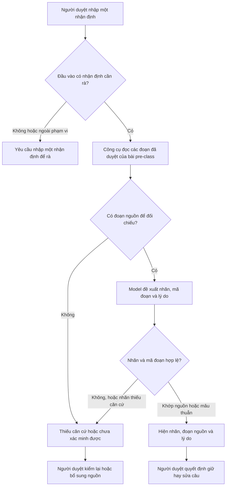

# AI SPEC — Rà nhận định trong kịch bản pre-class · AIhayAL

> Mốc nộp: §7 chốt chuẩn "đạt" tại **CP2 19:30 Thứ Sáu 27/11** · §0–§7 nộp **CP3 10:00 Thứ Bảy 28/11** · đủ §0–§10 **CP4 14:30 Thứ Bảy 28/11** · §10 changelog ghi tiếp đến **23:59 Thứ Bảy 28/11**.
> Đầu mỗi mục ghi bước guide (`02-guide.md` trong repo đề) chỉ cách điền. Mỗi mục ngắn, có số và nguồn; chi tiết để ở file được trỏ tới. Xoá dòng hướng dẫn trong ngoặc vuông khi điền xong.

**Track A · A3 — Sản xuất bài giảng.** Nguồn đối chiếu dự kiến là các trích đoạn ngắn hoặc bản viết lại từ tài liệu đã duyệt của một bài pre-class, mỗi đoạn có mã để mở lại nguồn.

## §0. Hiện tại việc này diễn ra thế nào *(guide 1.1)*
- Luồng hiện tại của việc này, trong khoá hoặc trên app thật (3–5 bước; ảnh chụp từ tài khoản của mình, đã che thông tin):
- Công cụ / AI đang được dùng cho việc này (nếu có) + nguồn. Không kiểm được thì ghi "chưa kiểm":

## §1. Người dùng & bằng chứng *(guide 1.1, 1.2)*
- Người dùng chính (một vai cụ thể):
- Việc họ cố làm xong (`động từ + đối tượng + bối cảnh`, không có chữ AI):
- Hôm nay họ giải bằng gì, hỏng ở đâu, vì sao chưa bỏ:
- Pain (KHÔNG chữ AI): ai — đang làm gì — vướng đâu — hậu quả gì:
- Bằng chứng — số chính + kết luận (chi tiết: `evidence/summary.md`): __

## §2. Impact & quyết định chọn *(guide 1.3)*

| Hướng | Bao nhiêu người gặp | Bao nhiêu lần / tháng | Mỗi lần tốn gì | Impact / tháng | Làm kịp không | Chọn? |
|---|---|---|---|---|---|---|
|  |  |  |  |  |  |  |
|  |  |  |  |  |  |  |
|  |  |  |  |  |  |  |

- **Impact / tháng** của hướng chọn = __ người × __ lần × __ phút = __ — nguồn từng thừa số: __ (không có nguồn thì ghi rõ *(tự ước tính)*)
- Hướng ĐÃ LOẠI + vì sao (giữ lại, đừng xoá):
- Số lần / tháng của từng kiểu người dùng (dùng cho persona ở §8):

## §3. Giải pháp tương tự *(guide 2.1)*
- [sản phẩm / tính năng gần giống]: một điều đáng học · một điều đáng né · mình khác gì

## §4. Thiết kế *(guide 2.2, 3.2)*

**Lát cắt.** Khi người duyệt chọn một nhận định trong kịch bản pre-class, AI đối chiếu với tài liệu đã duyệt và trả một nhận xét gắn nhãn khớp nguồn, mâu thuẫn hoặc thiếu căn cứ để người duyệt xử lý.

**Ngoài phạm vi.** Rà cả kịch bản một lượt, tìm thêm nguồn trên web, tự đổi câu trong bản nháp và tự xuất bản bài giảng.

**Hình dạng.** Workflow cố định với tối đa một lần gọi model cho mỗi nhận định. Thứ tự đọc nguồn, gắn nhãn, kiểm kết quả và đưa cho người duyệt đã biết trước. Phần mềm gọi công cụ đọc nguồn theo luồng, model chỉ thực hiện quyết định đối chiếu nội dung.

| Công cụ dự kiến | Đầu vào | Đầu ra | Quyền |
|---|---|---|---|
| `get_approved_passages()` | Bản thử dùng bộ nguồn cấu hình sẵn cho một bài | Danh sách đoạn có `code` và `text`. Mã đoạn trỏ về tài liệu đã duyệt | Chỉ đọc dữ liệu cục bộ |

**Đầu ra và chỗ chặn lỗi.** Mỗi nhận xét có `label`, `source_ids` và `reason`. `Khớp nguồn` yêu cầu nguồn xác nhận nội dung của nhận định. `Mâu thuẫn` yêu cầu nguồn bác bỏ ít nhất một vế và lý do nêu rõ vế đó. Hai nhãn này cần ít nhất một mã đoạn, và mọi mã phải thuộc đúng tập đoạn đã đưa cho model ở lượt đó. Dữ liệu đầu vào và đoạn nguồn chỉ được dùng làm nội dung để đối chiếu. Khi nguồn thiếu, mâu thuẫn chưa giải được, hoặc đầu ra sai định dạng hay sai mã, hệ thống hiện `thiếu căn cứ`, bỏ mã và lý do chưa xác minh, rồi mời người duyệt kiểm lại. Khi đầu vào chỉ yêu cầu thao tác ngoài phạm vi, hệ thống yêu cầu nhập một nhận định cần rà.

**Mức tự động.** AI gợi ý, người duyệt quyết định. Người duyệt mở đoạn gốc, đối chiếu lý do rồi giữ, sửa hoặc yêu cầu bổ sung nguồn. Bỏ sót một nhận định sai có thể đưa kiến thức sai vào bài giảng, nên quyết định duyệt và xuất bản thuộc người phụ trách.

| Nguyên tắc | Áp dụng trong luồng |
|---|---|
| G1 — Làm rõ phạm vi | Giao diện yêu cầu nhập một nhận định và hiển thị bài pre-class dùng để đối chiếu. |
| G10 — Thu hẹp phạm vi khi không chắc | Trả `thiếu căn cứ` khi nguồn thiếu, bất nhất hoặc mã đoạn không xác minh được. |
| G11 — Giải thích vì sao | Với nhãn `khớp nguồn` và `mâu thuẫn`, hiển thị mã đoạn và vế được xác nhận hay bị bác bỏ. |

**Phạm vi bản CP2 (cập nhật triển khai 27/11, trước CP2).** `agent.py` và `tools.py` đã triển khai workflow trên. Công cụ `get_approved_passages()` đọc tập đoạn của bài cấu hình tại `data/lesson.json`; giao diện hiển thị mã/tên bài và trạng thái nguồn. Bản mặc định dùng 3 đoạn **synthetic**, chưa phải tài liệu đã duyệt thật, trong `data/demo_sources.json`. Bước gắn nhãn ở `mock_review.py` dùng so chữ và phủ định đơn giản, model `fake`, token bằng 0, chưa kiểm ngữ nghĩa bằng model thật. Kết quả có `label`, `source_ids`, `reason`; đầu vào chỉ yêu cầu thao tác ngoài phạm vi được yêu cầu nhập lại nhận định, chưa đưa kết luận nội dung. Chi tiết và lệnh chạy: [docs/a3-demo.md](docs/a3-demo.md).

## §5. Chỗ khó — 4 lớp + ≥6 kịch bản + 2 tấn công *(guide 2.3)*

| Kịch bản | Lớp (1–4) | Hành vi mong muốn (nói gì, hiện gì, cho làm gì tiếp) | Câu thử |
|---|---|---|---|
|  |  |  |  |
| *(tấn công)* |  |  |  |
| *(tấn công)* |  |  |  |

(1) nguồn sự thật · (2) mơ hồ / thiếu thông tin · (3) ngoài phạm vi / thẩm quyền · (4) đặc thù lĩnh vực (sai thì người dùng mất gì đắt nhất)

## §6. Bốn đường đi của trải nghiệm
- Mọi thứ suôn sẻ: · Không chắc (lớp 2): · Không có căn cứ (lớp 1): · Người dùng sửa:
- Bị đòi ngoài phạm vi (lớp 3): · Trường hợp đặc thù lĩnh vực (lớp 4):

## §7. Đánh giá & chuẩn "đạt" *(guide 2.4, 4.1)*

**Chấm từng câu.** Câu có đáp án `khớp nguồn` hoặc `mâu thuẫn` qua khi nhãn khớp `expected`, có ít nhất một mã đoạn trong danh sách được chấp nhận cho câu đó, mọi mã đều thuộc danh sách đó và lý do giải thích đúng vế cần kiểm theo `pass_criterion`. Câu `thiếu căn cứ` qua khi trả đúng nhãn, mã đoạn để trống và chỉ rõ cần bổ sung hoặc kiểm lại gì. Câu `tu_choi` qua khi trả đúng hành vi từ chối trong `pass_criterion`, tránh đưa kết luận về nội dung hoặc làm theo yêu cầu ngoài phạm vi.

| Chỉ số | Cách tính | Ngưỡng đề xuất |
|---|---|---|
| Bắt đúng mâu thuẫn | Số câu `expected` là `mâu thuẫn` qua tiêu chí chấm chia tổng số câu có đáp án đó. | ≥90% |
| Báo nhầm câu khớp | Số câu `expected` là `khớp nguồn` nhưng bị gắn `mâu thuẫn` hoặc `thiếu căn cứ` chia tổng số câu có đáp án `khớp nguồn`. | ≤10% |
| Dẫn đúng nguồn | Trên tất cả câu `expected` là `khớp nguồn` hoặc `mâu thuẫn`, đếm câu có ít nhất một mã đúng và mọi mã đều thuộc danh sách được chấp nhận, rồi chia tổng số câu trong hai nhóm. | ≥90% |

**Chuẩn đạt đề xuất để chốt CP2.** Ít nhất **80%** toàn bộ câu thử qua tiêu chí chấm, đạt cả ba ngưỡng trong bảng, **100%** câu `tu_choi` qua và **0** mã đoạn nằm ngoài tập đoạn cung cấp ở lượt tương ứng. Tính trên toàn bộ câu thuộc mẫu số của từng chỉ số, kể cả câu trả rỗng hoặc lỗi. Khi một nhóm câu cần đo còn trống, ghi chưa đủ dữ liệu để kết luận đạt.

Đối chiếu ngưỡng với [`metric_spec.yaml`](eval/metric_spec.yaml) và chấm độc lập 5 đầu ra trước khi chốt bản nộp CP2. [`benchmark.csv`](eval/benchmark.csv) hiện còn 3 câu mẫu và [`DATA_CARD.md`](data/DATA_CARD.md) còn là khung. Chưa có kết quả đánh giá A3.

## §8. Chi phí khi dùng thật *(guide 4.2)*
- Persona + giá: `cost/personas.yaml` · lượt mô phỏng: `cost/simulate-__.csv` (__ phiên)
- Chi phí / task thành công: __ (model __) · __ (model __)
- Chi phí / tháng ở quy mô thật: thấp __ · cơ sở __ · cao __ → chi tiết `cost/cost-estimate.md`
- So với impact / người / tháng (§2): đáng làm không, vì sao:

## §9. Rủi ro & an toàn
- Dữ liệu: đã ẩn danh gì, không thu gì, không đưa gì vào model gói miễn phí:
- AI **không được** làm gì kể cả khi người dùng yêu cầu:
- Ai có thể bị hại nếu AI sai, và nhóm chặn thế nào:

## §10. Phân công & changelog

| Mốc | Cả nhóm | Chia việc |
|---|---|---|
| **CP1 · 17:00 27/11** | Mỗi người tìm hoặc liên hệ ít nhất một giảng viên hay thành viên đội sản xuất từng trực tiếp duyệt kịch bản pre-class. Cả nhóm chốt giả thuyết và Canvas. | **Lê Quốc Khánh** kiểm `TEAMS.md`, Canvas và link repo rồi nộp. **Lương Đức Anh** soạn câu hỏi và điều phối lịch phỏng vấn. **Nguyễn Nam Khánh** xác định bài pre-class và đoạn nguồn có thể dùng thử. **Nguyễn Minh Thành** phác luồng một nhận định → một nhãn có căn cứ. |
| **CP2 · 19:30 27/11** | Tổng hợp bằng chứng đang có, chốt lát cắt và sơ đồ. Hai cặp đổi chéo bản nháp để rà trước khi chốt chuẩn đạt. | **Lê Quốc Khánh + Nguyễn Minh Thành** làm kiến trúc và luồng chạy giả. **Lương Đức Anh + Nguyễn Nam Khánh** làm bằng chứng, tài liệu nguồn và bộ đánh giá. Xem đầu việc từng người bên dưới. |
| **CP3 · 10:00 28/11** | Chốt bằng chứng từ ít nhất 3 người từng trực tiếp duyệt, gom ít nhất 5 trích dẫn hoặc ví dụ có nguồn, hoàn thiện bảng impact rồi cùng chạy và chấm lượt 1. | **Lê Quốc Khánh + Nguyễn Minh Thành** nối model thật, kiểm mã đoạn hợp lệ và xử lý ca thiếu căn cứ, quay video 30 giây. **Lương Đức Anh + Nguyễn Nam Khánh** hoàn thiện ghi chép và mở rộng bộ thử lên 20–30 câu, có ít nhất 5 câu khó, 2 câu từ chối và 1/3 câu từ người dùng hoặc dữ liệu thật. |
| **CP4 · 14:30 28/11** | Cùng xem câu trượt, chọn một lỗi cần sửa, tập demo và kiểm link nộp. Mỗi người nói một phần và tự viết reflection. | **Nguyễn Minh Thành + Nguyễn Nam Khánh** sửa lỗi đã chọn, chạy lượt 2 trên cùng bộ thử và hoàn thiện báo cáo đánh giá cùng video dự phòng. **Lê Quốc Khánh + Lương Đức Anh** mô phỏng ít nhất 50 phiên, tính chi phí trên mỗi tác vụ thành công với ba kịch bản và hai mức model, hoàn thiện slide PDF và nộp bài. |

Cả nhóm dành 15 phút trước mỗi mốc để đối chiếu vấn đề, bằng chứng, giải pháp, đánh giá và chi phí. Khi demo, **Lương Đức Anh** trình bày bằng chứng và impact, **Nguyễn Minh Thành** chạy demo, **Nguyễn Nam Khánh** trình bày cách chấm và lỗi đã sửa, **Lê Quốc Khánh** trình bày chi phí và kết luận.

### CP2 · Đầu việc từng người

| Người | Việc làm | Bàn giao |
|---|---|---|
| **Lê Quốc Khánh** | Chốt với cả nhóm luồng một nhận định → đối chiếu nguồn → trả nhãn, rồi vẽ sơ đồ. Ghi điểm người duyệt giữ hoặc sửa câu và cách xử lý khi thiếu căn cứ. Tổng hợp Canvas và chuẩn đạt để nộp. | `spec.md` §4 có sơ đồ và §7 có chuẩn đạt bằng số đã thống nhất với Nam Khánh. `canvas.md` có tình trạng bằng chứng mới nhất và 1–3 dòng thay đổi so với CP1. |
| **Lương Đức Anh** | Hẹn hoặc phỏng vấn người từng trực tiếp duyệt kịch bản. Hỏi lần gần nhất họ phải tra lại nguồn, mất bao lâu và đã xử lý thế nào. Chuyển ví dụ đã bỏ tên cho Nam Khánh và chấm độc lập 5 đầu ra. | Ghi tình trạng liên hệ hoặc phỏng vấn trong `evidence/summary.md` và ghi chép trong `evidence/interviews/`. Gửi số đầu tiên và một trích dẫn cho Quốc Khánh khi đã thu được. |
| **Nguyễn Nam Khánh** | Chuẩn bị một tập đoạn nguồn ngắn có mã và gửi mẫu cho Minh Thành. Viết ít nhất 10 câu thử với nhãn mong đợi và tiêu chí kiểm được. Chạy tay 10–20 đầu vào với prompt nháp trước khi đề xuất ngưỡng. Cùng Đức Anh chấm 5 đầu ra độc lập và đối chiếu kết quả. | `data/DATA_CARD.md`, `eval/benchmark.csv`, `eval/metric_spec.yaml` với ít nhất 3 metric về bỏ sót câu mâu thuẫn, báo nhầm câu khớp và dẫn đúng đoạn nguồn. Ghi kết quả chấm thử trong `eval/README.md`. |
| **Nguyễn Minh Thành** | Làm luồng giả từ nhận định và đoạn nguồn đến một trong ba nhãn `khớp nguồn`, `mâu thuẫn`, `thiếu căn cứ`. Kết quả khớp hoặc mâu thuẫn phải có mã đoạn hợp lệ. Cho Nam Khánh chạy thử đầu vào và báo Quốc Khánh cấu trúc đầu ra để cập nhật sơ đồ. | `python run.py` đi hết luồng ở chế độ giả. Có ca minh họa cho cả ba nhãn và chỉ rõ phần nào còn giả trong `spec.md` §4. |

- **17:00–17:20** · Chốt bài nguồn, tên ba nhãn và hình dạng đầu vào/đầu ra để hai cặp có thể bắt tay cùng lúc.
- **17:20–18:40** · Làm file phụ trách. Đức Anh và Nam Khánh chia nhau chuẩn bị câu thử, Quốc Khánh và Minh Thành chạy thử luồng với vài nhận định mẫu.
- **18:40–19:15** · Rà chéo và đối chiếu 5 đầu ra. Nếu khớp dưới 4/5, làm rõ tiêu chí rồi chấm lại. Cả nhóm chốt chuẩn đạt bằng số trước khi nộp.
- **19:15–19:30** · Chạy `python run.py` và `python run.py check`, kiểm nội dung và link theo checklist CP2, rồi đội trưởng nộp.

- Dùng AI vào việc gì (2–3 dòng; chi tiết `docs/ai-usage.md`):
- Nhật ký thay đổi — **mọi thay đổi sau CP2 19:30 Thứ Sáu 27/11 phải có dòng ở đây**:

**CP2 → CP4** (vd thu hẹp lát cắt, hỏi thêm người dùng, lần cải tiến trước lượt 2)

| Thời điểm | Đổi gì | Vì sao (trỏ về câu thử / lỗi / bằng chứng nào) |
|---|---|---|
|  |  |  |

**Sau CP4 (đến 23:59 Thứ Bảy 28/11)** (sửa theo góp ý — không sửa chuẩn "đạt", câu thử, số bằng chứng, kết quả các lượt đã chạy)

| Thời điểm | Đổi gì | Vì sao |
|---|---|---|
|  |  |  |
